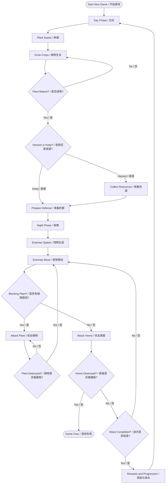

# Farm Defense — Core Gameplay Design Document

**Document Version:** 0.1
**Status:** Draft
**Related Issue:** #1 — Define Core Gameplay Loop and MVP Scope
**Project Type:** Farming / Tower Defense / Roguelite (Genre direction, subject to confirmation)
**Technology:** React + TypeScript + Vite + Canvas

---

# 1. Game Overview / 游戏概述

## 1.1 Game Concept / 游戏概念

**EN**

Farm Defense is a farming and tower-defense hybrid game. Players manage a small farm during the daytime and defend their home against waves of monsters at night.

Players grow crops, collect resources, discover mutated plants, and strategically decide whether to harvest plants or leave them on the field as defensive obstacles.

As the game progresses, enemies become stronger and more dangerous. Players must continuously improve their farming capabilities, discover new plant varieties, and strengthen their home to survive increasingly difficult nights.

**中文**

Farm Defense 是一款结合农场经营和塔防玩法的游戏。

玩家白天经营自己的农场，种植作物、收集资源、发现变异植物；夜晚则需要抵御一波又一波的怪物，保护自己的家园。

玩家需要在收获植物和将植物留在地上作为防御障碍之间做出策略选择。

随着游戏进程推进，怪物会变得越来越强大。玩家需要不断提升农场生产能力、发现新的植物种类，并强化房屋防御，以应对越来越困难的夜晚。

## 1.2 Core Gameplay Pillars / 核心玩法支柱

The game is built around four main gameplay pillars:

游戏围绕以下四个核心玩法支柱展开：

| Pillar / 支柱          | Description / 描述                                                                              |
| -------------------- | --------------------------------------------------------------------------------------------- |
| Farming / 农场经营       | Grow crops, collect resources, and manage farmland. / 种植作物、收集资源并管理耕地。                         |
| Tower Defense / 塔防战斗 | Use plants and defensive strategies to stop incoming enemies. / 利用植物和防御策略阻止怪物进攻。              |
| Mutation / 植物变异      | Discover special plants with unique attributes and offensive abilities. / 发现具有特殊属性和攻击能力的变异植物。 |
| Progression / 成长系统   | Upgrade the home, expand farmland, and unlock stronger plants. / 升级房屋、扩展耕地并解锁更强大的植物。          |

---

# 2. Core Gameplay Loop / 核心游戏循环

## 2.1 Gameplay Overview / 玩法流程

The game follows a repeating day/night cycle.

游戏采用循环式昼夜交替机制。

### Day Phase — Farming / 白天阶段：农场经营

**EN**

During the daytime, players focus on farming and preparation.

Players can:

- Plant seeds on available farming tiles.
- Wait for crops to grow.
- Harvest mature plants to collect resources.
- Leave mature plants on the field for nighttime defense.
- Manage seeds and resources.
- Prepare defensive strategies for the upcoming night.
- Upgrade the home when sufficient resources are available.

**中文**

白天阶段，玩家主要进行农场经营和战斗准备。

玩家可以：

- 在可用耕地上种植种子。
- 等待植物生长。
- 收获成熟植物以获取资源。
- 将成熟植物留在地上，作为夜晚的防御设施。
- 管理种子和资源。
- 为即将到来的夜晚制定防御策略。
- 在资源充足时升级房屋。

### Night Phase — Defense / 夜晚阶段：防御战斗

**EN**

During the nighttime, monsters spawn and move toward the player's home along predefined routes.

Players must defend their home using plants and other available abilities.

Core mechanics:

- Enemies follow predetermined movement routes.
- Plants can block enemy movement.
- Enemies can attack and destroy blocking plants.
- Destroyed plants no longer block enemy movement.
- Enemies continue toward the home after destroying obstacles.
- Enemies attack the home when they reach it.
- Defeating enemies may reward players with seeds, rare mutated seeds, and seed fragments.

**中文**

夜晚阶段，怪物会从指定位置生成，并沿着预设路线向玩家的房屋前进。

玩家需要利用植物和其他可用能力保护房屋。

核心机制：

- 怪物沿预设路线移动。
- 植物可以阻挡怪物前进。
- 怪物可以攻击并摧毁阻挡路线的植物。
- 植物被摧毁后，不再阻挡怪物移动。
- 怪物摧毁障碍物后继续向房屋前进。
- 怪物到达房屋后会对房屋造成伤害。
- 击败怪物有概率获得种子、稀有变异种子和种子碎片。

### Morning Phase — Recovery and Preparation / 黎明阶段：恢复与准备

**EN**

After all enemies in a wave are defeated or the wave otherwise ends, the game transitions back to daytime.

Players can review their resources, assess remaining plants, and prepare for the next night.

**中文**

当一波怪物全部被击败或该波次结束后，游戏重新进入白天。

玩家可以检查当前资源、评估剩余植物，并为下一个夜晚做准备。

---

## 2.2 Gameplay Flow Diagram / 游戏流程图

---

# 3. Farming System / 农场系统

## 3.1 Starting Resources / 初始资源

**EN**

Players start with a small farm, a home, and a limited number of potato seeds.

Potatoes are the initial crop and serve as the basic resource-generating plant.

**中文**

玩家开始时拥有一块小型农场、一栋房屋和有限数量的土豆种子。

土豆是游戏初始作物，也是最基础的资源生产植物。

Initial resources:

| Resource / 资源        | Initial State / 初始状态 |
| -------------------- | -------------------- |
| Home / 房屋            | 1                    |
| Potato Seeds / 土豆种子  | TBD                  |
| Farming Tiles / 耕地数量 | TBD                  |
| Other Seeds / 其他种子   | None / 无             |

具体初始数量将在后续平衡阶段确定。

## 3.2 Plant Growth / 植物生长

**EN**

Each plant has its own growth duration and growth stages.

When a plant reaches maturity, players can choose to harvest it or leave it on the field.

**中文**

每种植物都有自己的生长时间和生长阶段。

当植物成熟后，玩家可以选择收获，或者将其保留在地上。

## 3.3 Harvest vs. Defense / 收获与防御的选择

**EN**

Mature plants provide two possible strategic uses:

1. Harvest: Convert plants into resources for home upgrades and future farming.
2. Keep: Leave plants on the field to block enemy movement during nighttime.

Plants left on the field can be attacked and destroyed by enemies.

Players must balance short-term defense with long-term economic development.

**中文**

成熟植物有两种主要用途：

1. 收获：将植物转化为资源，用于房屋升级和后续农场发展。
2. 保留：将植物留在地上，在夜晚阻挡怪物移动。

留在地上的植物可以被怪物攻击并摧毁。

玩家需要在短期防御和长期经济发展之间做出平衡。

---

# 4. Combat System / 战斗系统

## 4.1 Enemy Movement / 怪物移动

**EN**

Enemies spawn at designated locations and follow predefined routes toward the home.

The initial version will use fixed routes rather than complex dynamic pathfinding.

**中文**

怪物从指定位置生成，并沿预先设定的路线向房屋移动。

初始版本采用固定路线，而不是复杂的动态寻路系统。

## 4.2 Plant Blocking and Destruction / 植物阻挡与摧毁

**EN**

Plants left on the field can act as physical obstacles.

When an enemy encounters a blocking plant:

1. The enemy stops moving.
2. The enemy attacks the blocking plant.
3. The plant loses health.
4. If plant health reaches zero, the plant is destroyed.
5. The enemy resumes movement along its route.

Different plants may have different health values and defensive characteristics.

**中文**

留在地上的植物可以作为物理障碍物。

当怪物遇到阻挡路线的植物时：

1. 怪物停止移动。
2. 怪物开始攻击阻挡路线的植物。
3. 植物损失生命值。
4. 当植物生命值降至零时，植物被摧毁。
5. 怪物继续沿原定路线移动。

不同植物可以具有不同的生命值和防御属性。

## 4.3 Home Defense / 房屋防御

**EN**

The home is the primary objective that players must protect.

Enemies can damage the home after reaching it.

The home has limited durability. If its durability reaches zero, the game ends.

**中文**

房屋是玩家必须保护的核心目标。

怪物到达房屋后可以对其造成伤害。

房屋具有有限的耐久度。当耐久度降至零时，游戏结束。

## 4.4 Enemy Waves / 怪物波次

**EN**

Each night consists of one or more enemy waves.

Enemy difficulty increases as the number of survived nights increases.

Difficulty may scale through:

- Increased enemy count.
- Increased enemy health.
- Increased enemy damage.
- Increased enemy movement speed.
- Introduction of new enemy types.

**中文**

每个夜晚由一波或多波怪物进攻组成。

随着玩家成功度过的夜晚增加，怪物难度逐渐提升。

难度可以通过以下方式增加：

- 增加怪物数量。
- 提高怪物生命值。
- 提高怪物攻击伤害。
- 提高怪物移动速度。
- 引入新的怪物类型。

---

# 5. Mutation and Reward System / 变异与奖励系统

## 5.1 Plant Mutation / 植物变异

**EN**

Plant mutations introduce special varieties with unique properties.

Mutations may occur during farming based on predefined probabilities.

Mutated plants may provide:

- Increased health.
- Increased defensive capabilities.
- Offensive abilities.
- Special effects against certain enemies.
- Improved resource production.

**中文**

植物变异系统用于引入具有独特属性的特殊植物。

种植过程中，植物可能根据预设概率发生变异。

变异植物可能获得：

- 更高的生命值。
- 更强的防御能力。
- 攻击能力。
- 针对特定怪物的特殊效果。
- 更高的资源产出。

## 5.2 Combat Rewards / 战斗奖励

**EN**

Defeated enemies may drop:

- Regular seeds.
- Rare mutated seeds.
- Seed fragments.
- Other upgrade resources.

Seed fragments may be used to unlock or obtain new plant varieties.

**中文**

击败怪物后可能掉落：

- 普通种子。
- 稀有变异种子。
- 种子碎片。
- 其他升级资源。

种子碎片可以用于解锁或获取新的植物种类。

---

# 6. Home Upgrade and Progression / 房屋升级与成长

## 6.1 Home Upgrades / 房屋升级

**EN**

Players can use harvested plants or collected resources to upgrade their home.

Home upgrades improve farming efficiency and expand available gameplay options.

Potential upgrades include:

- Increased farming area.
- Increased planting speed.
- Improved home durability.
- Additional farming capabilities.
- New gameplay features.

**中文**

玩家可以使用收获的植物或收集的资源升级房屋。

房屋升级能够提升农场生产效率，并解锁更多玩法。

潜在升级方向包括：

- 扩大耕地面积。
- 提高种植速度。
- 提升房屋耐久度。
- 解锁额外的农场功能。
- 解锁新的游戏机制。

## 6.2 Long-term Progression / 长期成长

**EN**

The overall progression is based on the relationship between farming, combat rewards, and home upgrades.

Players gradually develop a stronger farm and unlock more powerful plants while facing increasingly difficult enemies.

**中文**

整体成长系统围绕农场经营、战斗奖励和房屋升级之间的关系展开。

玩家逐步发展农场、解锁更强大的植物，同时面对越来越困难的怪物进攻。

---

# 7. Win and Lose Conditions / 胜负条件

## 7.1 Lose Condition / 失败条件

**EN**

The primary lose condition is home destruction.

When home durability reaches zero, the current run ends.

**中文**

主要失败条件是房屋被摧毁。

当房屋耐久度降至零时，本次游戏结束。

## 7.2 Win Condition / 胜利条件

**EN**

The final victory condition has not yet been defined.

Potential options include:

- Survive a predefined number of nights.
- Defeat a final boss.
- Complete a major progression objective.

**中文**

最终胜利条件暂未确定。

可考虑的方案包括：

- 成功度过指定数量的夜晚。
- 击败最终 Boss。
- 完成一个重要的成长目标。

---

# 8. MVP Scope / MVP 范围

## 8.1 MVP Goals / MVP 目标

**EN**

The first playable version should validate whether the core farming and tower-defense loop is fun and functional.

The MVP should focus on a small but complete gameplay experience rather than a large amount of content.

**中文**

第一个可玩版本的目标是验证农场经营和塔防循环是否有趣且能够正常运行。

MVP 应当优先保证玩法完整，而不是追求大量游戏内容。

## 8.2 Must Have — MVP Features / 必须实现的功能

- [ ] A basic grid-based farm map. / 基础网格农场地图。
- [ ] A home with limited durability. / 具有有限耐久度的房屋。
- [ ] Basic potato planting and growth. / 基础土豆种植和生长。
- [ ] Plant harvesting and resource collection. / 植物收获和资源收集。
- [ ] Mature plants can remain on the field. / 成熟植物可以保留在地上。
- [ ] Enemies follow predefined routes. / 怪物沿预设路线移动。
- [ ] Enemies can attack and destroy blocking plants. / 怪物能够攻击并摧毁阻挡路线的植物。
- [ ] Enemies can damage the home. / 怪物能够攻击房屋。
- [ ] A working day/night cycle. / 正常运行的昼夜循环。
- [ ] Basic enemy wave progression. / 基础怪物波次成长。
- [ ] Game-over condition. / 游戏失败机制。

## 8.3 Should Have — If Time Allows / 时间允许时实现

- [ ] Basic plant mutations. / 基础植物变异。
- [ ] At least one special plant. / 至少一种特殊植物。
- [ ] Basic combat rewards. / 基础战斗奖励。
- [ ] First home upgrade. / 第一级房屋升级。
- [ ] Additional enemy types. / 更多怪物类型。

## 8.4 Out of Scope — Future Features / 暂不纳入 MVP 的功能

- Complex plant evolution trees. / 复杂的植物进化树。
- Large plant catalogs. / 大规模植物图鉴。
- Complex enemy AI and dynamic pathfinding. / 复杂怪物 AI 和动态寻路。
- Multiple maps and biomes. / 多张地图和不同生态区域。
- Advanced protagonist skill trees. / 完整的主角技能树。
- Multiplayer gameplay. / 多人联机玩法.
- Advanced animations and visual effects. / 高级动画和视觉特效。

---

# 9. Initial Design Decisions and Open Questions / 初始设计决策与待讨论问题

The following decisions need to be discussed and finalized before or during MVP implementation.

以下问题需要在 MVP 实现之前或过程中讨论并确定。

| Topic / 主题                  | Current Decision / 当前决定                             | Status / 状态 |
| --------------------------- | --------------------------------------------------- | ----------- |
| Day/Night Transition / 昼夜切换 | Repeating day/night cycle / 循环昼夜机制                  | Proposed    |
| Enemy Movement / 怪物移动       | Fixed predefined routes / 固定路线                      | Proposed    |
| Plant Blocking / 植物阻挡       | Plants block enemies / 植物阻挡怪物                       | Confirmed   |
| Plant Destruction / 植物摧毁    | Enemies can attack and destroy plants / 怪物可以攻击并摧毁植物 | Confirmed   |
| Home Durability / 房屋耐久度     | Limited health; zero means game over / 有限耐久度，归零则失败  | Proposed    |
| Plant Mutation / 植物变异       | Probability-based mutation / 概率触发变异                 | Proposed    |
| Difficulty Scaling / 难度成长   | Enemies get stronger every night / 怪物逐夜增强           | Confirmed   |
| Victory Condition / 胜利条件    | Not decided / 尚未决定                                  | Open        |
| Protagonist Combat / 主角战斗   | Not decided / 尚未决定                                  | Open        |
| Daytime Timer / 白天时间限制      | Not decided / 尚未决定                                  | Open        |
| Plant Regrowth / 植物再生       | Not decided / 尚未决定                                  | Open        |

---

# 10. Future Design Documents / 后续设计文档

This document defines the overall gameplay framework. Detailed mechanics will be maintained in separate documents.

本文档定义整体玩法框架，具体机制将在独立文档中维护。

| Document                  | Related Issue | Description                                               |
| ------------------------- | ------------- | --------------------------------------------------------- |
| Farm Map Design / 农场地图设计  | #2            | Map layout, grid, tiles, and expansion / 地图布局、网格、地块和扩展    |
| Plant Design / 植物设计       | #3            | Crop catalog, growth, and plant attributes / 作物图鉴、生长和植物属性 |
| Mutation Design / 变异设计    | #4            | Mutation types and evolution tree / 变异类型和进化路线             |
| Enemy Design / 怪物设计       | #5            | Enemy archetypes, behavior, and waves / 怪物类型、行为和波次        |
| Protagonist Design / 主角设计 | #6            | Player attributes and skills / 玩家属性和技能                    |
| Progression Design / 成长设计 | #7            | Home upgrades and resource economy / 房屋升级和资源经济            |

---

# 11. Document Change History / 文档修改记录

| Version | Date       | Changes                                                 |
| ------- | ---------- | ------------------------------------------------------- |
| 0.1     | 2026-10-30 | Initial gameplay concept and MVP draft / 初始玩法概念和 MVP 草稿 |
